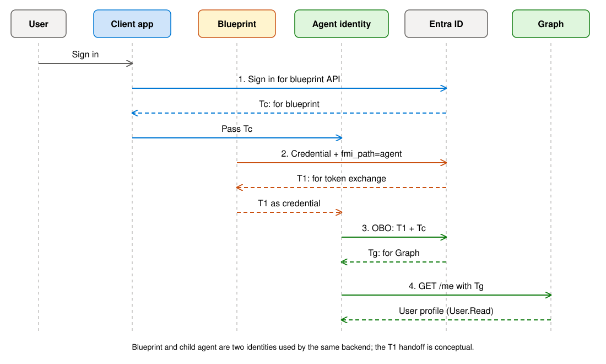

# Entra Agent ID: on-behalf-of token exchange, explained by running it

This notebook shows **a real Microsoft Entra Agent ID identity acting on behalf of a signed-in user**. It makes the token requests one at a time, displays their parameters without exposing credentials, and then calls Microsoft Graph.

The notebook plays both the frontend and the agent backend. There is no LLM or deployed agent application to set up. The identity, consent records, and tokens are real.

## Presentation

The [30-slide PowerPoint walkthrough](output/Entra-Agent-ID-OBO-Exchange.pptx) explains the full exchange with editable diagrams, exact token requests, speaker notes, and operator references for permissions, state, and cleanup. Examples are illustrative; the presentation distinguishes offline verification from a live tenant rehearsal.

## The idea in one minute

Think of **a ticket, a badge, and a pass**:

1. **Tc -- the user's ticket:** a normal client app signs the user in and receives an access token addressed to the **blueprint's API**, not Microsoft Graph.
2. **T1 -- the agent's badge:** the blueprint authenticates with its credential and names its child agent identity. Entra returns an exchange token.
3. **Tg -- the Graph pass:** the child presents **T1 to prove who the agent is** and **Tc to represent the user**. Entra checks the tokens, the permission grant, and policy, then issues a new access token for Graph.

**All three tokens are issued by Entra.** OBO does not modify Tc, forward the administrator's token, or turn the user into an application-only identity.



Read from top to bottom. Setup and consent happen beforehand; the blueprint and child agent are two identities used by the same backend, not necessarily separate services.

| Token | Requested by | Intended recipient (`aud`) | What to notice |
|-------|--------------|----------------------------|----------------|
| **Tc** | Public client, with the signed-in user | Blueprint API | `oid` identifies the user; `scp` contains `access_agent`; `azp` identifies the public client. |
| **T1** | Blueprint, naming its child with `fmi_path` | Token-exchange resource | The blueprint is the authenticating client. Entra binds the FMI subject to the child. |
| **Tg** | Child agent, presenting both T1 and Tc | Microsoft Graph | The user remains the subject; the child agent is the actor; this demo grants `User.Read`. |

Graph sometimes uses v1 claim names: `appid` instead of `azp`, and `upn` instead of `preferred_username`. Do not assume T1's `sub` is literally the child appId. Graph access tokens can also be opaque; the notebook reports that instead of inventing claims or failing an otherwise valid Graph call.

### The two requests after user sign-in

These are the actual parameters used in notebook sections 8 and 9. Requests go to your tenant's `https://login.microsoftonline.com/<tenant-id>/oauth2/v2.0/token` endpoint as **form-encoded data**, not JSON.

```text
T1: blueprint proves which agent it represents
grant_type    = client_credentials
client_id     = <BLUEPRINT_APP_ID>
client_secret = <blueprint credential, hidden>
scope         = api://AzureADTokenExchange/.default
fmi_path      = <AGENT_APP_ID>
```

```text
Tg: child agent requests a Graph token on behalf of the user
grant_type            = urn:ietf:params:oauth:grant-type:jwt-bearer
client_id             = <AGENT_APP_ID>
client_assertion_type = urn:ietf:params:oauth:client-assertion-type:jwt-bearer
client_assertion      = <T1>
assertion             = <Tc>
requested_token_use   = on_behalf_of
scope                 = https://graph.microsoft.com/.default
```

The important switch is **`client_id`: blueprint for T1, child agent for Tg**. The two assertions in the OBO request have different jobs: `client_assertion` authenticates the agent; `assertion` supplies the user context.

Here, Graph `/.default` requests already-granted permissions. It does **not** mean every Graph permission, and this non-interactive OBO exchange cannot obtain missing user consent. Other flows can use `/.default` to prompt for configured permissions. The token-exchange request uses `api://AzureADTokenExchange/.default`; do not generalize this example into a claim that every OBO resource request must use `/.default`.

## What the notebook does

**Prepare before presenting -- sections 1-6:**

1. Resolve your tenant ID, sign in an administrator, check read access, and request explicit provisioning confirmation.
2. Create a blueprint application, a seven-day development secret, its `access_agent` API scope, and its blueprint principal.
3. Register an ordinary public client and preauthorize it for the blueprint's `access_agent` scope.
4. Have the provisioning administrator create one child agent identity using `AgentIdentity.Create.All`.
5. Grant the child delegated Graph `User.Read` for **one selected demo user**, not everyone in the tenant.

**Show the audience -- sections 7-11:**

1. Sign in the selected user to obtain **Tc**.
2. Send the explicit blueprint request to obtain **T1**.
3. Send the explicit child OBO request to obtain **Tg**.
4. Use Tg for `GET /me` successfully; show that the same token is denied access to `GET /users`.
5. Compare the tokens' audiences, subjects, actors, and scopes.

**Section 12 is optional cleanup.** The administrator's setup token is separate from Tc, T1, and Tg. Setup uses a single explicit administrator identity rather than hiding an app-only provisioning flow or silently falling back between identities.

## Prerequisites

- A **Microsoft Entra workforce development tenant in the global cloud**, with work/school accounts. Do not use `common`, `organizations`, a personal Microsoft account, or a production tenant for an unapproved rehearsal.
- A provisioning administrator with the roles described below. Activate PIM roles **before** signing in.
- A **member user** for the user-facing demonstration. By default, this is the provisioning administrator signing in a second time in a different application context. A separate, non-admin member user is preferable when available.
- Python **3.11 or newer**. On Windows, use an **x64 Python build**, including on ARM64 Windows: MSAL's `cryptography` dependency currently has Windows x64 wheels, but no Windows ARM64 wheel.
- Network access to `login.microsoftonline.com` and `graph.microsoft.com`, plus a browser. Package installation also needs access to your approved Python package source.
- Tenant policy must permit the chosen public client, sign-in method, app/agent creation, delegated consent, and a short-lived client secret. Device-code sign-in can be blocked by Conditional Access; `AUTH_MODE=interactive` provides the browser authorization-code alternative when your policy allows it. Do not disable policy to make the demo pass.

Agent ID platform availability is not a guarantee that a particular tenant/account can perform these operations. Agent 365 security/governance capabilities have separate licensing considerations; see the [current Agent ID overview](https://learn.microsoft.com/en-us/entra/agent-id/what-is-microsoft-entra-agent-id). This sample uses v1.0 blueprint APIs and `/beta` child-identity APIs, which can evolve.

## Permissions

There are **three different permission relationships**. Keeping them separate is the key to understanding the demo.

| Relationship | Who receives the permission | What it allows |
|--------------|-----------------------------|----------------|
| Provisioning | Bootstrap client acting with the administrator | Create/configure this demonstration's directory objects and consent. |
| Frontend to agent API | Public client, preauthorized on the blueprint | Request Tc with `api://<blueprint-appId>/access_agent`. No Graph access is granted here. |
| Agent to Graph | Child agent identity, for the selected user | Obtain Tg with delegated `User.Read` and read that user's profile. |

### Directory roles: what the administrator may do

For this **secret-based** notebook, use an approved account with:

- **Agent ID Administrator** to manage Agent ID objects and add the blueprint secret. Agent ID Developer can create blueprints and configure federated credentials, but **is not sufficient for this secret-creation step**.
- **Cloud Application Administrator** or **Application Administrator** for the ordinary client application and delegated permission consent.

An appropriately authorized Global Administrator can also perform the setup, but broad elevation is not the default recommendation. Roles do not replace OAuth scopes, and consenting to scopes does not assign a directory role.

The **demo user needs no administrator role for OBO**. Selecting the administrator again merely avoids needing a second account. No administrative role or provisioning scope is assigned to the child agent.

### Delegated Graph scopes: what the bootstrap client may do

Section 2 requests these **11 delegated permissions**, defined with their purposes in `demo_support.py` and the [Microsoft Graph permissions reference](https://learn.microsoft.com/en-us/graph/permissions-reference). An administrator must approve the bootstrap client's permissions according to tenant policy.

| Delegated scope | Why this notebook requests it |
|-----------------|-------------------------------|
| `User.Read` | Read the administrator's own profile with `/me`. |
| `Application.ReadWrite.All` | Create/read/configure the ordinary public client and its service principal. This is a powerful setup permission, not an agent runtime grant. |
| `AgentIdentityBlueprint.Read.All` | Find/read the blueprint, its API configuration, and credential metadata on reruns. |
| `AgentIdentityBlueprint.Create` | Create the blueprint application. |
| `AgentIdentityBlueprint.AddRemoveCreds.All` | Add the development-only blueprint client secret. |
| `AgentIdentityBlueprint.UpdateAuthProperties.All` | Configure identifier URI, API scope, preauthorization, and required resource access. |
| `AgentIdentityBlueprintPrincipal.Read.All` | Find/read the blueprint principal. |
| `AgentIdentityBlueprintPrincipal.Create` | Create the blueprint principal. |
| `AgentIdentity.Read.All` | Find/read the child agent identity. |
| `AgentIdentity.Create.All` | Create the child agent identity as the administrator. |
| `DelegatedPermissionGrant.ReadWrite.All` | Read/write the child's one-user delegated Graph grant. This is also a powerful setup permission. |

The default bootstrap app is **Microsoft Graph Command Line Tools** (`14d82eec-204b-4c2f-b7e8-296a70dab67e`), the app used by `Connect-MgGraph`. Do not substitute an Azure CLI token: this notebook requires explicit setup/cleanup scopes and rejects tokens carrying `Directory.AccessAsUser.All`. This bootstrap safeguard is separate from the platform's restrictions on permissions granted to agent identities themselves.

If your organization disallows the default bootstrap client, use an **organization-approved ordinary public-client registration** via `BOOTSTRAP_CLIENT_ID`. Configure the delegated Graph permissions above, grant the required admin consent, enable public-client flows, and register **Mobile and desktop applications > `http://localhost`** if using interactive browser sign-in. It needs no client secret. Creating/approving this bootstrap registration is an administrator prerequisite, not a privilege the child agent acquires.

### Runtime Graph permission: what the agent may do

Section 6 writes an `oauth2PermissionGrant` with:

```text
clientId    = child agent's SERVICE PRINCIPAL OBJECT ID (AGENT_ID)
resourceId  = Microsoft Graph's SERVICE PRINCIPAL OBJECT ID in this tenant
consentType = Principal
principalId = selected demo user's OBJECT ID
scope       = User.Read
```

**Object IDs are not appIds.** OAuth `client_id` and `fmi_path` use appIds; the grant's `clientId` and `resourceId` use service-principal object IDs.

`Principal` restricts this grant to the selected user. `AllPrincipals` would grant consent for every user in the tenant; this notebook deliberately does not use it. The grant authorizes profile access **on behalf of that user**, not app-only access or unrestricted impersonation.

The blueprint's `requiredResourceAccess` also declares `User.Read` for visibility. A declaration is not consent. No inheritance is configured here. In other deployments, effective token permissions can combine direct and inherited grants, and access remains subject to the user's own rights and tenant policy.

Existing broader, tenant-wide, or different-user grants cause a stop rather than being silently modified. `GET /users` requires at least `User.ReadBasic.All`; it should return HTTP 403 with this demo's `User.Read` token. A server/network error is **not** evidence of the permission boundary.

### Cleanup and optional log viewing

Cleanup signs in again and requests the necessary read/grant/client permissions plus these three delegated delete permissions:

- `AgentIdentity.DeleteRestore.All`
- `AgentIdentityBlueprintPrincipal.DeleteRestore.All`
- `AgentIdentityBlueprint.DeleteRestore.All`

Ordinary client/principal deletion uses `Application.ReadWrite.All`. The separate cleanup sign-in means delete permissions are not required for the live token walkthrough.

Viewing agent sign-in logs in the portal requires a suitable role such as **Reports Reader**. The notebook does not request `AuditLog.Read.All` or fetch tenant-wide logs. Logs describe authentication/token activity and can arrive later; the Graph responses are the immediate demonstration of API behavior.

## Setup

**This workstation already has an x64 `.venv` and the `Entra OBO demo (.venv)` kernel prepared.** Use that environment rather than recreating it with the native ARM64 `python` command.

For a fresh Windows environment with Python 3.13 x64 registered, run from this folder:

```powershell
py -3.13-64 -m venv .venv
.\.venv\Scripts\python.exe -m pip install --only-binary=:all: -r requirements.txt
.\.venv\Scripts\python.exe -m ipykernel install --prefix .venv --name entra-obo-demo --display-name "Entra OBO demo (.venv)"
if (-not (Test-Path .env)) { Copy-Item .env.example .env }
```

The binary-only install fails clearly if the Python architecture is unsupported instead of starting a Rust/C++ build. On this ARM64 workstation, an isolated official Python 3.13.15 **x64** runtime was used without changing system Python or PATH. If this specific environment needs rebuilding:

```powershell
$demoPython = Join-Path $env:LOCALAPPDATA "EntraOboDemo\runtimes\python-3.13.15-x64\tools\python.exe"
& $demoPython -m venv .venv
```

Then rerun the dependency/kernel commands above. A fresh machine needs its own x64 Python installation; that private runtime directory is not included in this repository.

Edit `.env`:

| Setting | Value |
|---------|-------|
| `TENANT_ID` | Your development tenant ID or verified domain. Required. |
| `AGENT_PREFIX` | A unique name for this rehearsal, such as `obo-demo-september`. |
| `BOOTSTRAP_CLIENT_ID` | Default Graph Command Line Tools app, or your approved public client. |
| `AUTH_MODE` | `device_code` (default) or `interactive`. Choose a policy-permitted method. |
| `DEMO_USER_OBJECT_ID` | Optional object ID of a different member user in the same tenant. Blank uses the provisioning administrator. |
| `AGENT_STATE_FILE` | Optional state-file path. Prefer the default private location described below. |

Environment variables take precedence over `.env`. Restart the kernel after changing settings. Do not copy `.env.example` over an existing configured `.env`.

## Run

```powershell
.\.venv\Scripts\python.exe -m notebook entra_agent_obo.ipynb
```

In Jupyter, select **Entra OBO demo (.venv)**. In VS Code, select this project's **`.venv\Scripts\python.exe`** as the notebook interpreter. Run cells in order.

### Rehearsal and audience script

Run sections **1-6 before the session**, complete the administrator sign-in, check the resolved tenant, and type the prefix to confirm provisioning. Leave the same kernel open.

For the audience, run sections **7-11**:

| Section | What to say | What to show |
|---------|-------------|--------------|
| 7 -- Tc | "The user gives the agent a ticket for its API, not for Graph." | `aud` is the blueprint; `oid` is the selected user; `scp` is `access_agent`. |
| 8 -- T1 | "The blueprint proves the identity of its child agent." | Blueprint `client_id`, child `fmi_path`, exchange audience, and the T1 fingerprint. |
| 9 -- Tg | "The agent combines its badge and the user's ticket." | Child `client_id`; `client_assertion=T1`; `assertion=Tc`; Graph audience and `User.Read`. |
| 10 -- Graph | "The pass works only within the granted access." | `/me` returns the selected user; `/users` is denied with HTTP 403. |
| 11 -- recap | "Same user, different actor, a new token for a different API." | Side-by-side claims, or an explicit opaque-token notice. |

If a token expires while you are speaking, rerun sections 7-10. The live sign-in user must match `DEMO_USER_OBJECT_ID` or the administrator chosen by default. Keep `CLEANUP = False` during the demonstration.

### State and safe reruns

On Windows, the default state is `%LOCALAPPDATA%\EntraOboDemo\<tenant-id>-<prefix>.json`, **outside this OneDrive-backed workspace**. It contains object IDs and the blueprint's plaintext development secret. Keep it private; do not move it into a shared/synced folder.

State is bound to the resolved tenant, prefix, and demo user. Reruns reuse recorded objects, scope IDs, exact grants, and a saved credential only while its key still exists and is unexpired. The API scope ID is saved before the Graph update and reused if a later read is stale. The recorded grant is read by ID as well as checking the grant collection; an empty, stale list does not cause duplicate creation. Changed scope IDs and missing, changed, or replaced recorded grants stop the run.

A stale or expired credential is replaced; `ROTATE_SECRET = True` in the credential cell permits explicit rotation. Restore that switch to `False` afterward. **Rotation adds a new Entra credential and updates the local saved value; it does not revoke older credentials.** Older credentials remain until expiry, explicit removal, or blueprint deletion. Do not treat this switch as complete remediation for a compromised secret.

Rerunning section 1 or 2 clears previous provisioning approval, as does enabling cleanup. Confirm provisioning again in section 2 before further setup writes; finish any partial cleanup before starting another provisioning run.

Do **not** delete state to fix a failed exchange: that loses the resource/credential association. An untracked matching name, changed object, or incompatible grant stops the notebook. If a create request times out, creation might have completed; inspect the named object and preserve/recover state rather than blindly repeating writes. Use one kernel per state file.

Clear outputs and execution counts before sharing or committing. Token fingerprints are shown instead of raw tokens, but decoded claims and profiles still identify people and tenant objects.

### Offline checks

These run the actual notebook cells with mocked authentication and Graph transport, including reruns, stale directory reads, credential replacement, invalid token claims, opaque Graph tokens with or without scope metadata, both sign-in modes, and cleanup after a simulated kernel restart or partial failure. The fake transport checks which token is used, honors `$select`, and blocks accidental live HTTP requests. **These checks are not a live tenant rehearsal.**

```powershell
.\.venv\Scripts\python.exe -m unittest -v
```

Run one focused check:

```powershell
.\.venv\Scripts\python.exe -m unittest tests.test_demo.HelperTests.test_only_access_denied_403_counts_as_permission_boundary -v
```

Run one full mocked notebook replay, including rerun and cleanup:

```powershell
.\.venv\Scripts\python.exe -m unittest tests.test_demo.NotebookTests.test_full_notebook_replay_and_cleanup_with_mocked_transport -v
```

## Cleanup

Run section 12 only when you are done. Set `CLEANUP = True`, confirm `delete <prefix>`, and complete the cleanup administrator sign-in. Before any deletion, the notebook checks the tenant and all requested cleanup scopes and rejects `Directory.AccessAsUser.All`; active roles and per-object authorization still need to permit the operations.

Cleanup explicitly removes only the recorded consent grant, child agent, public-client principal/application, and blueprint principal/application. It refuses a blueprint with additional child identities. If any deletion fails, it **keeps the state file** so you can resolve permissions and retry. To recover after restarting the kernel or an incomplete setup, run **section 1, then section 12**.

Agent ID objects are soft-deleted for 30 days; restoring them requires Graph or Microsoft Entra PowerShell. Entra can also cascade blueprint/principal deletion to child identities asynchronously; this notebook deletes recorded children first instead of depending on that timing. Do not assume an admin-center restore action exists. Local state deletion alone does not remove cloud objects or revoke their credentials. Already-issued access tokens can remain valid until expiration.

The notebook does not revoke the administrator's consent to the shared bootstrap application, because other tools may rely on it. An administrator should review any newly approved bootstrap permissions under the organization's normal consent process.

## Common errors

Read the full Entra/Graph error and request/correlation ID; a single code can have more than one cause.

| Symptom | Meaning / action |
|---------|------------------|
| `403 Authorization_RequestDenied` during setup | Check both the requested Graph scopes and active directory roles. Agent ID read/create/delete scopes are distinct. The notebook also refuses a bootstrap token carrying `Directory.AccessAsUser.All`. |
| `AADSTS50013` during OBO | Assertion validation failed. In this flow, check that Tc targets the blueprint, not Graph; also check token lifetime and the complete error text. |
| `AADSTS65001` | Consent is missing or not yet propagated. Check the child agent object ID, Graph resource object ID, `Principal`/user ID, and `User.Read` grant in section 6. |
| `AADSTS65002` | First-party application/resource preauthorization problem, **not** a generic invalid-scope error. Verify the bootstrap client; use an approved registration rather than reusing an unsuitable Microsoft app ID. |
| `AADSTS700016` | Application not found in this tenant, or a newly created registration has not propagated. Check tenant and appId; bounded retries handle fresh registrations. |
| `AADSTS7000215` / `AADSTS7000222` | Invalid / expired client secret. Rerun the credential cell; use explicit rotation if necessary. Keep the state file. |
| `AADSTS53003`, `interaction_required`, or device-code denial | Tenant policy requires a different allowed authentication path or further user interaction. Consult the sign-in error; use browser mode only if permitted. Do not bypass policy. |
| `AgentIdentity_AgentBlueprintPrincipalDoesNotExist` | Create/read back the blueprint principal in section 3 and allow propagation before creating the child. |
| A property/permission is unsupported, or a quota is reached | Check the current Agent ID API reference and tenant limits. Do not automatically broaden permissions or permanently delete other objects. |
| `/users` returns 401/404/500 or unexpectedly succeeds | Not a valid permission-boundary demonstration. Fix token/network/API errors, or investigate unexpected direct/inherited permissions. |
| Python tries to build `cryptography` and reports missing `link.exe` | Use x64 Python and binary wheels on Windows; do not build an authentication dependency merely to run this notebook. |

## For production

This notebook keeps raw exchanges visible for teaching. It is not a production resource server: diagnostic claim checks are **not cryptographic token validation**. A real backend must validate incoming Tc with an approved library before authorization/OBO, and treat access tokens for other APIs as opaque.

Prefer federated credentials with managed identities or certificates over saved client secrets, review direct versus inheritable permissions, and use a supported SDK such as `Microsoft.Identity.Web.AgentIdentities` or the Microsoft Entra ID Auth SDK sidecar. Do not ship the notebook's local plaintext credential store.

## References

- [Agent OBO protocol and audience/linkage requirements](https://learn.microsoft.com/en-us/entra/agent-id/agent-on-behalf-of-oauth-flow)
- [Create and configure a blueprint; administrator roles](https://learn.microsoft.com/en-us/entra/agent-id/create-blueprint)
- [Create child agent identities](https://learn.microsoft.com/en-us/graph/api/agentidentity-post?view=graph-rest-beta)
- [Delegated permission-grant schema and object-ID requirements](https://learn.microsoft.com/en-us/graph/api/oauth2permissiongrant-post?view=graph-rest-1.0)
- [Declarations, direct grants, and inheritance](https://learn.microsoft.com/en-us/entra/agent-id/concept-inheritable-permissions)
- [The `.default` scope and preauthorization](https://learn.microsoft.com/en-us/entra/identity-platform/scopes-oidc)
- [Interactive authentication versus consent-only flows](https://learn.microsoft.com/en-us/entra/agent-id/interactive-agent-authentication-authorization-flow)
- [Agent token claims and opaque-token guidance](https://learn.microsoft.com/en-us/entra/agent-id/agent-tokens)
- [List-users permission requirements](https://learn.microsoft.com/en-us/graph/api/user-list?view=graph-rest-1.0)
- [Agent ID limits, propagation, and recovery FAQ](https://learn.microsoft.com/en-us/entra/agent-id/faq)
- [Agent ID deletion and asynchronous cascade behavior](https://learn.microsoft.com/en-us/entra/agent-id/concept-agent-identity-deletion)
- [Delete and restore agent identity objects](https://learn.microsoft.com/en-us/entra/agent-id/howto-delete-agent-identity)
- [Agent sign-in and audit logs](https://learn.microsoft.com/en-us/entra/agent-id/sign-in-audit-logs-agents)
- [Verify the Microsoft Graph Command Line Tools application ID](https://learn.microsoft.com/en-us/troubleshoot/entra/entra-id/governance/verify-first-party-apps-sign-in#application-ids-of-microsoft-tenant-owned-applications)
- [Microsoft Entra authentication error-code reference](https://learn.microsoft.com/en-us/entra/identity-platform/reference-error-codes)
- [Official AADSTS65002 explanation](https://login.microsoftonline.com/error?code=65002)

## Verification Summary

Reviewed on **2026-09-12** across the README, notebook narrative and code, support module, tests, Copilot instructions, configuration template, ignore rules, and both diagram formats. **50 grouped cross-file claims** were checked against the implementation, Microsoft references, and local execution: **43 confirmed, 6 corrected, 1 tenant-dependent**.

Corrections preserve scope IDs through stale reads and failed updates, reuse consent by its recorded ID, validate cleanup consent and clear stale provisioning approval, clarify that secret rotation does not revoke earlier credentials, distinguish the notebook's bootstrap safeguard from permissions blocked for agents, and correct the token helper's documented call signature.

**Local result:** 48 offline tests pass. Coverage includes full replays, both sign-in modes, credential expiry/rotation, rejected token claims, delayed directory reads, opaque Graph tokens, and cleanup after partial failure or a simulated kernel restart. Dependencies pass `pip check`; the registered kernel starts on Python 3.13.15 x64, and the authenticated local notebook server serves the notebook and SVG. Both diagram sources agree, and the SVG was rendered and visually inspected. Sources also parse using Python 3.11 grammar; execution was checked on the installed 3.13 runtime.

**A live run in your tenant has not been verified.** No tenant provisioning, real token exchange, or tenant deletion was performed in this review. Local checks cannot prove your roles, consent policy, Conditional Access, quotas, or the exact tokens Entra will issue. Rehearse sections 1-11 with the provisioning administrator and selected demo user in the intended development tenant before presenting.
